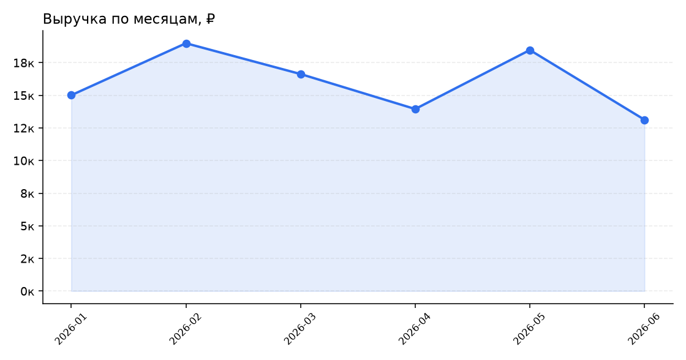
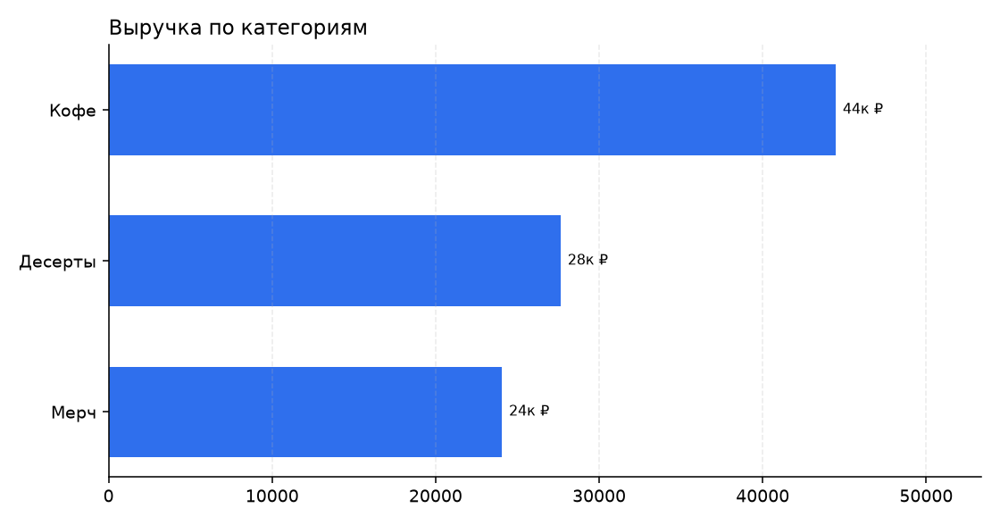
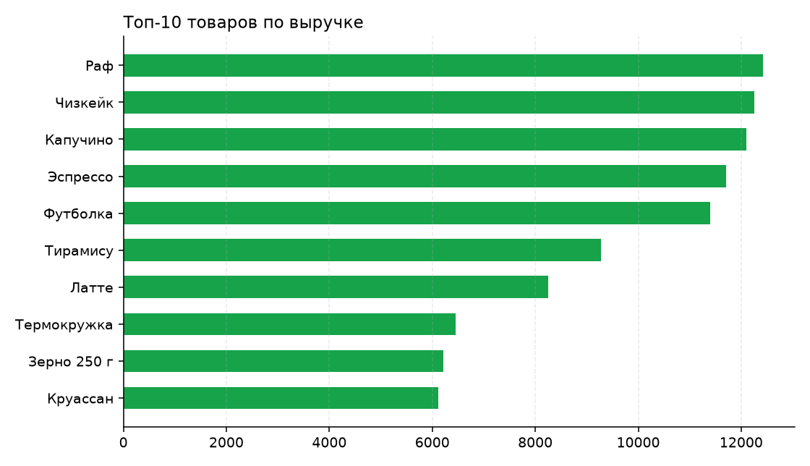

# data-report

Отчёт по продажам из CSV: графики PNG, сводка в Markdown и Excel с тремя
листами. Одна команда — готовый файл, который можно отправить руководителю.

Задачи, под которые это делают: разбор выгрузки из 1С/маркетплейса/CRM,
ежемесячный отчёт, поиск провалившихся категорий.



## Что умеет

- сам определяет разделитель CSV (запятая, `;`, таб) и формат даты;
- приводит типы, отбрасывает строки с невалидной датой, считает выручку;
- KPI: выручка, заказы, средний чек, штуки, выручка в месяц, число позиций;
- три графика: динамика по месяцам, категории, топ-10 товаров;
- `summary.md` с таблицами и вставленными графиками;
- `report.xlsx` с листами «Товары», «По месяцам», «Сырые данные».

| Категории | Топ товаров |
|---|---|
|  |  |

## Установка и запуск

```bash
git clone https://github.com/kuruma4/data-report
cd data-report
pip install -r requirements.txt
python report.py data/sample_sales.csv --out out
```

```
Готово. Показатели:
  Выручка: 96 180
  Заказов: 184
  Средний чек: 523
  Продано штук: 330
  Выручка в месяц: 16 030
  Позиций: 10
Файлы: out/summary.md, out/report.xlsx, out/charts/
```

## Формат входных данных

```csv
date,category,product,qty,price
01.01.2026,Кофе,Эспрессо,10,150
01.01.2026,Десерты,Чизкейк,2,350
```

| Колонка | Обязательна | Примечание |
|---|---|---|
| `date` | да | `01.01.2026` или `2026-01-01` |
| `category` | да | группа товара |
| `product` | да | название |
| `qty` | да | количество |
| `price` | да | цена за штуку в рублях |

Лишние колонки игнорируются, порядок любой.

## Тесты

```bash
python -m unittest discover -s tests -v
```

Проверяются расчёт выручки, KPI, отбрасывание невалидных дат и понятная
ошибка при нехватке колонки.

## Ограничения

- Не подключается к 1С/API напрямую: на вход нужен CSV или Excel
  (конвертация — 15 минут работы).
- Не прогнозирует: это описательная аналитика. Прогноз — отдельная задача
  (pandas + модель, обсуждается).
- Кириллица в Excel-выгрузке требует `utf-8-sig` — уже учтено.

## Заказ

Нужен разбор ваших данных? Telegram: [@kuruma44](https://t.me/kuruma44)
